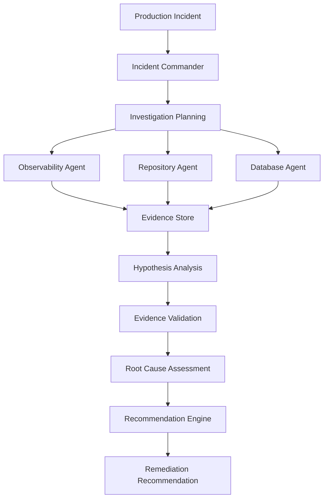
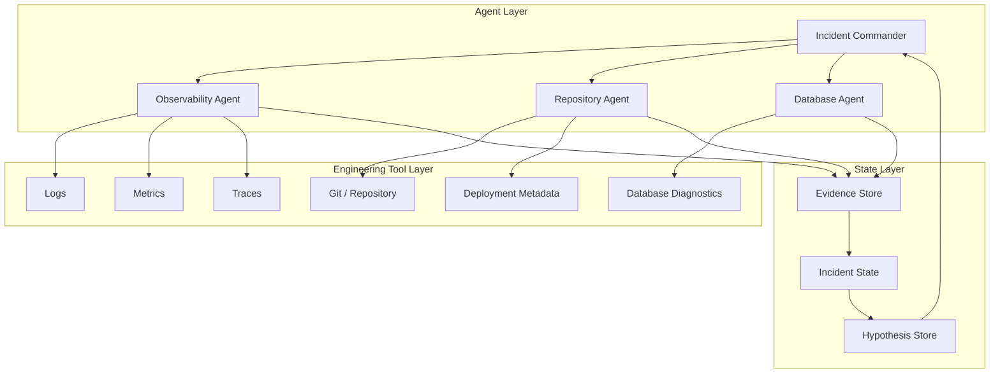
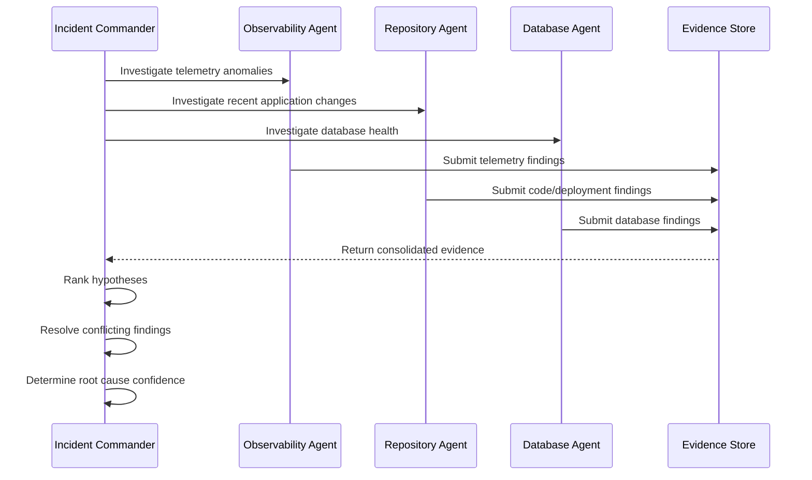
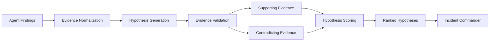
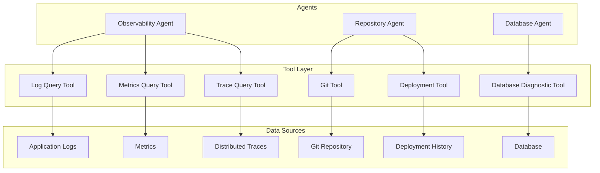
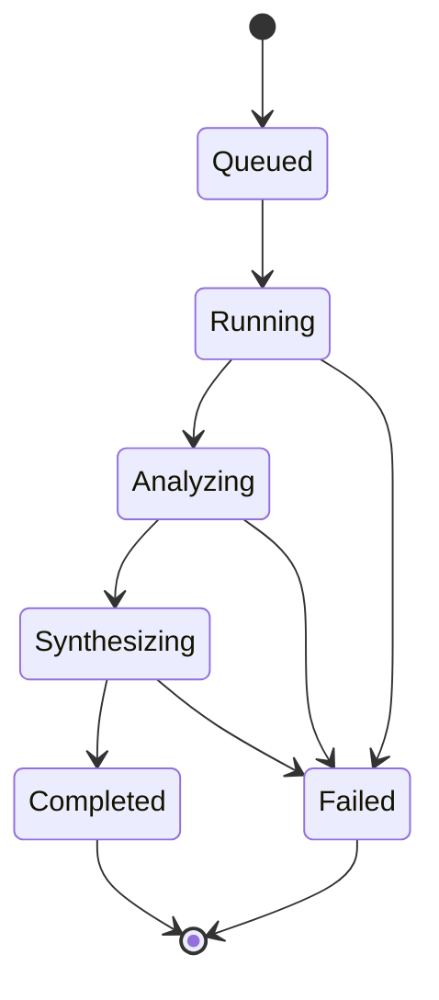
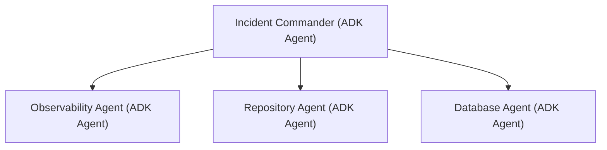
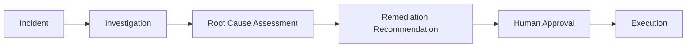

# IncidentForge

### Multi-Agent AI System for Production Incident Investigation

IncidentForge is a multi-agent engineering incident response system that investigates production incidents through a virtual team of specialized AI engineers.

Rather than relying on a single agent to diagnose an incident, IncidentForge decomposes the investigation across specialized engineering roles. Agents independently collect evidence from logs, metrics, traces, repositories, deployments, and databases before contributing their findings to an Incident Commander.

The Incident Commander correlates evidence, evaluates competing hypotheses, resolves conflicting findings, and produces a root-cause assessment and remediation recommendation.

Built with **Python, Google ADK, Gemini, FastAPI, React, and TypeScript.**

---

## Overview

Production incidents rarely have a single obvious explanation.

A sudden increase in API latency could be caused by:

* a recent deployment
* database contention
* a downstream dependency
* infrastructure degradation
* configuration changes
* unusual traffic
* resource exhaustion

Traditional monitoring systems can identify that something is wrong. IncidentForge focuses on determining **why it is happening** and **what should be done next**.

The system models incident response as a collaborative engineering workflow:



---

## Architecture

IncidentForge is organized around three major layers:

1. **Agent Layer** — specialized engineering roles
2. **Tool Layer** — interfaces to operational and engineering data
3. **State Layer** — shared evidence, hypotheses, and investigation state



---

## Agent Team

IncidentForge models incident response as a team of specialized engineering roles. Each agent has a defined responsibility, toolset, and investigation perspective.

### Incident Commander

The Incident Commander is the coordinating agent responsible for managing the overall investigation.

Responsibilities include:

* understanding the incident and establishing severity
* decomposing the investigation into specialized tasks
* delegating tasks to appropriate agents
* maintaining shared incident state
* correlating findings from multiple agents
* identifying contradictory evidence
* ranking competing root-cause hypotheses
* determining when sufficient evidence has been collected
* coordinating remediation planning

The Incident Commander does not simply select the answer generated by another agent. It synthesizes evidence collected across the investigation.

---

### Observability Agent

Investigates the system through operational telemetry.

Analyzes:

* application logs
* service metrics
* distributed traces
* latency distributions
* error rates
* resource utilization
* service health

Its primary responsibility is determining **where abnormal behavior originates and how it propagates through the system**.

---

### Repository Agent

Investigates application-level behavior and recent software changes.

Analyzes:

* recent deployments
* Git commits
* code changes
* API behavior
* dependency changes
* application architecture

The Repository Agent can correlate an incident with a recently introduced application change.

---

### Database Agent

Investigates failures originating from the data layer.

Analyzes:

* query latency
* slow queries
* database resource utilization
* connection pools
* locks
* transaction behavior

An important responsibility is also **eliminating the database as a root-cause candidate when available evidence does not support that hypothesis**.

---

## Agent Collaboration

The agents are not intended to behave as a simple sequence of prompts.

Each specialist investigates the incident independently and contributes structured findings to the shared investigation state.



This allows the system to reason from **multiple independent perspectives** rather than relying on a single model response.

---

## Evidence-Driven Reasoning

A core design principle of IncidentForge is:

> **Agent conclusions are hypotheses; evidence is what determines confidence.**

Each agent contributes structured findings.

For example:

```text
Agent: Database Engineer

Finding:
Database query latency remained within normal limits.

Evidence:
Average query latency: 22 ms
Database CPU: 34%
Lock contention: None

Hypothesis:
Database degradation

Confidence:
Low
```

Another agent may report:

```text
Agent: Repository Engineer

Finding:
A synchronous inventory service call was introduced
during the latest checkout deployment.

Evidence:
Deployment: checkout-service v1.8.2
Commit: 8f31a2

Hypothesis:
Downstream inventory dependency causing request blocking

Confidence:
High
```

The Incident Commander uses these findings to update the relative confidence of competing hypotheses.



---

## Shared Incident State

The investigation maintains a shared state containing the information accumulated throughout the incident.

Conceptually:

```text
Incident State
│
├── Incident Metadata
│   ├── ID
│   ├── Severity
│   ├── Affected Services
│   └── Customer Impact
│
├── Agent Findings
│   ├── Observability
│   ├── Repository
│   └── Database
│
├── Evidence
│   ├── Logs
│   ├── Metrics
│   ├── Traces
│   └── Code Changes
│
├── Hypotheses
│   ├── Candidate Causes
│   ├── Confidence
│   └── Supporting Evidence
│
└── Recommended Actions
```

This shared state allows later agents to build on earlier discoveries without losing the context of the investigation.

---

## Tool Architecture

Agents interact with engineering systems through specialized tools rather than directly accessing arbitrary data.



This abstraction allows simulated incident data to be used during development while keeping the architecture ready for real integrations.

---

## Investigation Lifecycle

IncidentForge uses a canonical investigation state machine:



**Canonical Status States:**
- `queued` — Investigation created, waiting to start
- `running` — Investigation actively executing (triage phase)
- `analyzing` — Specialist agents collecting evidence (observability, repository, database)
- `synthesizing` — Incident Commander correlating findings, generating hypotheses
- `completed` — Investigation finished with recommendations
- `failed` — Unrecoverable error occurred

**Progress milestones** are tied to actual execution stages:
- queued: 0%
- triage: 10%
- observability: 25%
- repository: 45%
- database: 65%
- correlation: 75%
- synthesis: 85%
- recommendation: 95%
- completed: 100%

---

## Google ADK Integration

IncidentForge uses **Google Agent Development Kit (ADK)** as its agent orchestration framework.

The system is structured around:
* specialized agents with ADK `Agent` instances
* agent delegation via the Incident Commander
* tool-based execution using ADK `FunctionTool` wrappers
* shared investigation state passed between agents
* structured outputs using Pydantic models as `output_schema`
* modular workflows with deterministic fallback when API keys are unavailable

For example:



Each specialist agent:
1. Is instantiated as a Google ADK `Agent` with a model, instruction, and tools
2. Has deterministic tools exposed as ADK `FunctionTool` for logs, metrics, traces, git, deployments, and database analysis
3. Uses the ADK `Runner` and `InMemorySessionService` for execution
4. Returns structured `Finding` objects via `output_schema`
5. Falls back to deterministic analysis when Google API key is not configured

---

## API & Real-time Updates

**REST API (FastAPI):**
- `POST /api/v1/investigations` — Create investigation from scenario or manual input
- `GET /api/v1/investigations` — List all investigations
- `GET /api/v1/investigations/{id}` — Get investigation summary
- `GET /api/v1/investigations/{id}/state` — Get full investigation state
- `GET /api/v1/investigations/{id}/timeline` — Get timeline events
- `GET /api/v1/investigations/{id}/evidence` — Get collected evidence
- `GET /api/v1/investigations/{id}/findings` — Get agent findings
- `GET /api/v1/investigations/{id}/recommendations` — Get recommendations
- `POST /api/v1/investigations/{id}/recommendations/{index}/approve` — Approve recommendation
- `POST /api/v1/investigations/{id}/recommendations/{index}/reject` — Reject recommendation

**Server-Sent Events (SSE):**
- `GET /api/v1/investigations/{id}/stream` — Live investigation updates
- Emits: initial state snapshot, timeline events, completion signal
- Handles reconnection with event cursor to prevent duplicate replay

---

## Web UI (React + TypeScript)

**Dashboard:**
- Investigation statistics (Total, Running, Completed, Failed)
- Recent investigations table with real timestamps and durations
- Status badges matching canonical state machine

**Investigation Detail:**
- Header: scenario name, investigation ID, status, stage, elapsed time
- Stage progress indicator with canonical stages
- Live timeline feed via SSE
- Collapsible sections for Evidence, Findings, Hypotheses, Recommendations
- Agent status panel (Pending/Running/Completed)
- Recommendation approval workflow

---

## Scenarios

Two built-in incident scenarios for testing and demonstration:

| Scenario | Incident ID | Description |
|----------|-------------|-------------|
| `payment_latency` | INC-2026-1042 | Checkout API latency spike caused by downstream dependency slowdown and retry amplification |
| `db_lock_contention` | INC-2026-1055 | Database lock contention on payments table causing elevated 500 errors |

Each scenario includes:
- Incident metadata (id, title, description, severity, affected services)
- Structured logs with timestamps, severity, service, message
- Metric series with anomaly window
- Distributed traces with spans and slow span identification
- Deployment history with timestamps and notes
- Git commits with messages and affected services

---

## Evaluation

Agentic systems should be evaluated using repeatable scenarios rather than only qualitative demonstrations.

IncidentForge includes a test suite that validates:

- Investigation completes successfully for each scenario
- Expected evidence types are discovered (metric, log, trace, code, deployment, database)
- Findings are produced by each invoked agent
- Hypotheses are synthesized from findings
- Recommendations are generated with approval requirement
- Timeline contains all key investigation events
- State transitions follow canonical state machine

Run evaluation:
```bash
pytest tests/ -v
```

---

## Safety and Human Oversight

IncidentForge follows a **recommendation-first** approach.

The system can investigate incidents and evaluate potential recovery strategies, but destructive production actions are not executed without explicit authorization.



Recommendations are created with `requires_approval: true` by default. The API provides approve/reject endpoints that update recommendation status and emit timeline events.

---

## Project Structure

```text
incidentforge/
│
├── agents/
│   ├── incident_commander/
│   ├── observability/
│   ├── repository/
│   └── database/
│
├── tools/
│   ├── observability/
│   ├── repository/
│   └── database/
│
├── scenarios/
│   ├── payment_latency/
│   └── db_lock_contention/
│
├── evaluation/
│
├── app/
│   ├── routes.py
│   ├── schemas.py
│   ├── main.py
│   └── config.py
│
├── orchestrator/
│   ├── state_manager.py
│   ├── dispatcher.py
│   ├── coordinator.py
│   ├── recommendation_engine.py
│   ├── workflow.py
│   └── evidence_store.py
│
├── models/
│   ├── incident.py
│   ├── evidence.py
│   ├── finding.py
│   ├── hypothesis.py
│   ├── recommendation.py
│   ├── investigation.py
│   └── state.py
│
├── tests/
│
├── frontend/
│   ├── src/
│   │   ├── pages/
│   │   │   ├── Dashboard.tsx
│   │   │   ├── InvestigationDetail.tsx
│   │   │   └── NewInvestigation.tsx
│   │   ├── hooks/
│   │   │   ├── useInvestigations.ts
│   │   │   └── useInvestigationStream.ts
│   │   ├── api/
│   │   │   └── client.ts
│   │   └── types/
│   │       └── api.ts
│   └── package.json
│
├── requirements.txt
├── pyproject.toml
└── README.md
```

---

## Technology Stack

| Category            | Technology                      |
| ------------------- | ------------------------------- |
| Language            | Python 3.11+                    |
| Agent Framework     | Google ADK 2.7.1                |
| Foundation Model    | Gemini (optional, for LLM path) |
| Backend             | FastAPI 0.141+                  |
| Observability Tools | Logs, Metrics, Traces (simulated) |
| Code Analysis       | Git / Repository Tools          |
| Interface           | React 18 + TypeScript + Vite    |
| Evaluation          | pytest + scenario-based tests   |

---

## Quick Start

### Prerequisites
- Python 3.11+
- Node.js 18+
- (Optional) Google API key for LLM-enhanced analysis

### Backend
```bash
cd /path/to/IncidentForge
python -m venv .venv
source .venv/bin/activate
pip install -r requirements.txt

# Optional: Set Google API key for LLM mode
export GOOGLE_API_KEY=your-key-here

# Start backend
uvicorn app.main:app --reload --port 8000
```

### Frontend
```bash
cd frontend
npm install
npm run dev
```

### Run Demo
1. Open http://localhost:5173 (frontend)
2. Click "New Investigation"
3. Select "payment_latency" or "db_lock_contention"
4. Click "Start Investigation"
5. Watch live updates via SSE on the Investigation Detail page

---

## Demo Script (for Interviews)

1. **Start backend**: `uvicorn app.main:app --reload`
2. **Start frontend**: `cd frontend && npm run dev`
3. **Open Dashboard** at http://localhost:5173
4. **Click "New Investigation"**
5. **Select "payment_latency"** scenario
6. **Click "Start Investigation"** — navigates to detail page
7. **Watch live SSE updates**:
   - Status: queued → running → analyzing → synthesizing → completed
   - Progress: 0% → 10% → 25% → 45% → 65% → 75% → 85% → 95% → 100%
   - Timeline events appear in real-time
8. **Evidence appears** from Observability (metrics, logs, traces), Repository (commits, deployments), Database
9. **Findings appear** from each agent with confidence scores
10. **Hypotheses synthesized** with supporting evidence
11. **Recommendation generated** with rationale, risk, confidence
12. **Status becomes "completed"**, Dashboard reflects completed investigation
13. **Repeat with "db_lock_contention"** to show different agent selection

---

## What's Implemented

✅ **FastAPI backend** with REST API and SSE streaming  
✅ **React + TypeScript frontend** with Dashboard and Investigation Detail  
✅ **Multi-agent investigation** (Incident Commander, Observability, Repository, Database)  
✅ **Google ADK integration** — each specialist agent is an ADK Agent with FunctionTools  
✅ **Deterministic telemetry analysis** (logs, metrics, traces)  
✅ **Repository/deployment correlation** (commits, deployments, overlap scoring)  
✅ **Database analysis** (query latency, locks, contention detection)  
✅ **SSE live updates** — real-time timeline, evidence, findings, hypotheses, recommendations  
✅ **Canonical state machine** — queued, running, analyzing, synthesizing, completed, failed  
✅ **Meaningful progress tracking** tied to actual execution stages  
✅ **Structured findings, hypotheses, recommendations** with evidence linkage  
✅ **Scenario-based testing** with payment_latency and db_lock_contention  
✅ **Recommendation approval workflow**  

---

## Future Extensions

🔄 **Security Agent** — authentication failures, suspicious traffic, rate limiting  
🔄 **Documentation Agent** — RAG-based runbook retrieval (ChromaDB + embeddings scaffolded)  
🔄 **Performance Agent** — critical path analysis, dependency graphs  
🔄 **Release Manager** — rollback, feature-flag, hotfix evaluation  
🔄 **Postmortem Agent** — automated incident report generation  
🔄 **Production persistence** — PostgreSQL, Redis for state storage  
🔄 **Real integrations** — Prometheus, OpenTelemetry, GitHub, CI/CD  

---

## Design Principles

### Specialization over Generalization

Each agent is responsible for a clearly defined engineering domain.

### Evidence over Opinions

Agent conclusions are treated as hypotheses and must be supported by evidence.

### Collaboration over Sequential Prompting

Agents contribute independent perspectives and can challenge competing hypotheses.

### Recommendation before Automation

The system separates investigation and recommendation from production execution.

### Continuous Evaluation

Agent behavior is measured using repeatable incident scenarios.

### Extensibility

New agents, tools, data sources, and incident scenarios can be introduced without changing the core architecture.

---

## Author

**Shalini Kashyap**

Computer Science & Engineering